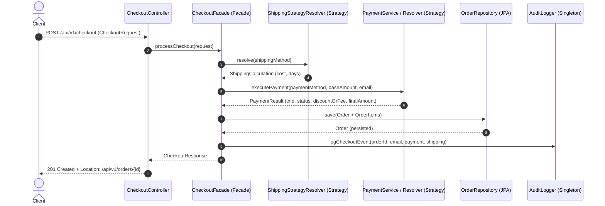

# E-Commerce Checkout API — Padrões de Projeto GoF com Spring Boot

[](https://github.com/marcondesjr89/ecommerce-checkout-gof/actions/workflows/ci.yml)
[](https://github.com/marcondesjr89/ecommerce-checkout-gof/actions/workflows/cd.yml)


API REST de **Checkout & Gestão de Pedidos** desenvolvida em **Java 21** e **Spring Boot 3** para demonstrar a aplicação prática dos **Padrões de Projeto GoF (Gang of Four)** em uma arquitetura modular (**Clean Architecture / Package-by-Feature**) com esteira **Shift-Left CI/CD**, cobertura **JaCoCo** e publicação automatizada no **GitHub Container Registry (GHCR)**.

---

## Padrões de Projeto (GoF) Aplicados

| Padrão | Categoria | Implementação no Projeto | Benefício Prático |
| :--- | :--- | :--- | :--- |
| **Strategy** | Comportamental | `PaymentStrategy` (`PixPaymentStrategy`, `CreditCardPaymentStrategy`, `BoletoPaymentStrategy`) + `PaymentStrategyResolver` | Elimina `if/switch` via injeção polimórfica do Spring (`Map<PaymentMethod, PaymentStrategy>`), respeitando o princípio Aberto-Fechado (OCP). |
| **Strategy** | Comportamental | `ShippingStrategy` (`ExpressShippingStrategy`, `EconomyShippingStrategy`) + `ShippingStrategyResolver` | Regras intercambiáveis de frete (Expresso R$ 35,00 em 1 dia útil; Econômico R$ 15,00 ou grátis a partir de R$ 200,00 em 5 dias úteis). |
| **Facade** | Estrutural | `CheckoutFacade` (`orders/application/CheckoutFacade.java`) | Unifica e encapsula em uma única operação `@Transactional` a validação de carrinho, cálculo de frete, processamento de pagamento, persistência JPA e auditoria. |
| **Singleton** | Criacional | `AuditLogger` (`platform/observability/AuditLogger.java`) + Spring IoC Container | Instância única thread-safe (`final instanceId` + `AtomicLong`) gerenciada nativamente pelo escopo Singleton do `ApplicationContext`. |

---

## Fluxo de Orquestração (Facade + Strategy + Singleton)



---

## Arquitetura do Projeto (Package-by-Feature + Clean Architecture)

```text
src/main/java/com/dio/gof/
├── ProjetoGofApplication.java
├── orders/                           # Bounded Context: Pedidos, Frete & Checkout
│   ├── api/                          # CheckoutController, OrderController, DTOs (Records + Bean Validation)
│   ├── application/                  # CheckoutFacade (GoF Facade), OrderApplicationService, ShippingStrategyResolver
│   ├── domain/                       # Order, OrderItem, OrderStatus, ShippingStrategy, ShippingMethod, ShippingCalculation
│   └── infrastructure/               # OrderRepository (JPA + LEFT JOIN FETCH), ExpressShippingStrategy, EconomyShippingStrategy
├── payment/                          # Bounded Context: Pagamentos
│   ├── application/                  # PaymentService, PaymentStrategyResolver (GoF Strategy)
│   ├── domain/                       # PaymentStrategy, PaymentMethod, PaymentStatus, PaymentResult
│   └── infrastructure/               # PixPaymentStrategy, CreditCardPaymentStrategy, BoletoPaymentStrategy
└── platform/                         # Cross-cutting / Plataforma
    ├── api/                          # GlobalExceptionHandler (RFC 7807 ProblemDetail), BusinessException, ResourceNotFoundException
    ├── config/                       # OpenApiConfig (Swagger UI / OpenAPI 3)
    └── observability/                # AuditLogger (GoF Singleton thread-safe)
```

---

## Como Executar

### Pré-requisitos
- **Java 21 LTS**
- **Docker & Docker Compose** (para o banco PostgreSQL 16)

### 1. Subir o banco de dados PostgreSQL
```bash
docker compose up -d
```

### 2. Executar a aplicação via Maven Wrapper
```bash
# Windows (PowerShell)
.\mvnw.cmd spring-boot:run

# Linux / macOS
./mvnw spring-boot:run
```

### 3. Ou executar a imagem publicada no GHCR
```bash
docker pull ghcr.io/marcondesjr89/ecommerce-checkout-gof:latest
```

### 4. Acessar a Documentação Interativa (Swagger UI)
- **Swagger UI:** `http://localhost:8080/swagger-ui.html`
- **OpenAPI JSON:** `http://localhost:8080/v3/api-docs`

---

## Endpoints REST & Exemplos

| Método | Rota | Descrição | Status de Sucesso |
| :--- | :--- | :--- | :--- |
| `POST` | `/api/v1/checkout` | Executa o checkout completo via `CheckoutFacade` | `201 Created` + Header `Location` |
| `GET` | `/api/v1/orders` | Lista todos os pedidos com itens (`LEFT JOIN FETCH`) | `200 OK` |
| `GET` | `/api/v1/orders/{id}` | Busca detalhada de um pedido por ID | `200 OK` / `404 Not Found` |

### Exemplo: Checkout com PIX (10% de desconto) + Frete Expresso (R$ 35,00)
```bash
curl -X POST http://localhost:8080/api/v1/checkout \
  -H "Content-Type: application/json" \
  -d '{
    "customerName": "Lucia Ferreira",
    "customerEmail": "lucia@example.com",
    "postalCode": "01001-000",
    "shippingMethod": "EXPRESS",
    "paymentMethod": "PIX",
    "items": [
      { "productName": "Mechanical Keyboard", "quantity": 1, "unitPrice": 100.00 },
      { "productName": "Mouse Pad", "quantity": 2, "unitPrice": 25.00 }
    ]
  }'
```

**Resposta (`201 Created`):**
```json
{
  "orderId": 1,
  "customerEmail": "lucia@example.com",
  "shippingMethod": "EXPRESS",
  "shippingCost": 35.00,
  "estimatedDeliveryDays": 1,
  "paymentMethod": "PIX",
  "subtotal": 150.00,
  "discountOrFee": -18.50,
  "totalAmount": 166.50,
  "status": "PAID",
  "paymentTransactionId": "PIX-A1B2C3D4",
  "paymentMessage": "Pagamento via PIX aprovado com 10% de desconto."
}
```

### Padronização de Erros (RFC 7807 — `ProblemDetail`)
- **`400 Bad Request`:** Erros de validação Bean Validation (`MethodArgumentNotValidException`) ou argumentos inválidos.
- **`404 Not Found`:** Recurso não encontrado (`ResourceNotFoundException`).
- **`422 Unprocessable Entity`:** Violação de regra de negócio (`BusinessException`).
- **`500 Internal Server Error`:** Resposta genérica segura sem exposição de stack trace ou detalhes internos.

---

## Testes, Cobertura JaCoCo e Esteira Shift-Left CI/CD

### Executar testes e gerar relatório JaCoCo localmente
```bash
.\mvnw.cmd clean verify
```
O relatório HTML de cobertura é gerado em `target/site/jacoco/index.html`.

| Métrica de Qualidade | Resultado Verificado |
| :--- | :--- |
| **Suíte Automatizada (JUnit 5 + Mockito + MockMvc + `@DataJpaTest`)** | **34 testes (100% verdes)** |
| **Cobertura de Classes (JaCoCo)** | **100.0% (31/31)** |
| **Cobertura de Instruções (JaCoCo)** | **99.4% (1246/1254)** |
| **Cobertura de Linhas (JaCoCo)** | **99.0% (290/293)** |
| **Cobertura de Métodos (JaCoCo)** | **98.0% (100/102)** |

### Pipeline GitHub Actions
1. **CI Pipeline (`.github/workflows/ci.yml`)** — executa em `push` e `pull_request` na `main`:
   - **`build-and-test`**: Compilação Java 21, suíte completa de testes (`./mvnw clean verify -B`) e upload do artefato JaCoCo.
   - **`security-audit`**: Varredura completa do histórico Git com **Gitleaks** contra vazamento de segredos.
   - **`docker-build-check`**: Validação do build multi-stage do `Dockerfile` com cache BuildKit (`push: false`).
2. **CD Pipeline (`.github/workflows/cd.yml`)** — gate estrito:
   - Acionado **exclusivamente** via `workflow_run` quando o `CI Pipeline` conclui com `conclusion == 'success'` na branch `main` (ou via `workflow_dispatch`).
   - Faz checkout do SHA exato aprovado no CI e publica a imagem hardened (usuário não-root `appuser`) em `ghcr.io/marcondesjr89/ecommerce-checkout-gof` com tags `:latest` e `:sha-<commit>`.
